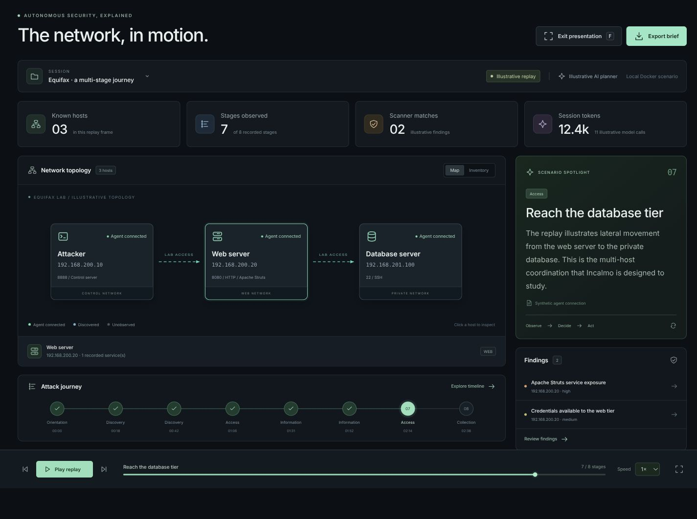
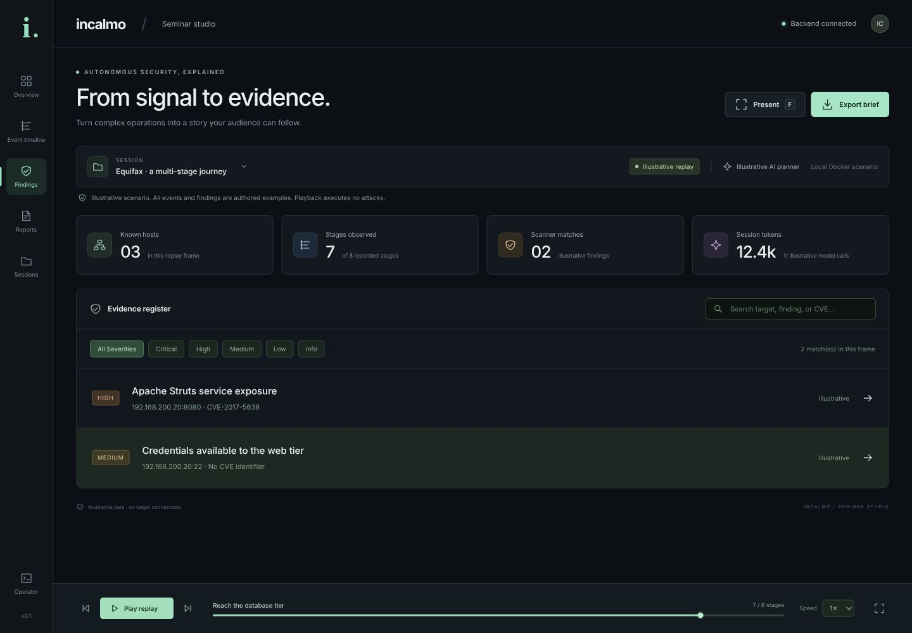

# Incalmo：用于多主机网络红队测试的自主大语言模型辅助系统

> **本地版本说明：安装源已改为中国科学技术大学（中科大／USTC）镜像。**
>
> - 实验镜像中的 Kali Linux 和 Ubuntu apt 软件源使用中科大镜像，并增加了下载重试和超时设置。
> - pip 安装 `uv`，以及项目的 `uv sync`、`uv run` 所用 Python 包索引，使用 `https://mirrors.ustc.edu.cn/pypi/simple`。
> - Go 模块使用 `https://goproxy.cn,direct`，这不是中科大镜像；模块不可用时可回退到直接下载。
> - Docker 基础镜像、Go 编译器压缩包和 Metasploit 安装脚本仍从原始来源下载。
>
> 当前本地实验配置使用 DeepSeek Flash（API 模型名为 `deepseek-flash`）。英文原文保存在 [README.en.md](README.en.md)。

<div align="center">

[](https://choosealicense.com/licenses/mit/)


Incalmo 是一款自主 AI 驱动的网络渗透测试工具，能够自动开展智能红队测试，旨在增强和辅助操作人员执行复杂网络攻击任务的能力。

**研究论文：**[使用大语言模型执行多阶段网络攻击的可行性研究（On the Feasibility of Using LLMs to Execute Multistage Network Attacks）](https://arxiv.org/abs/2501.16466)

**官方网站：**访问 [Incalmo 网站](https://www.incalmo.ai/) 了解更多信息。

</div>

---

## Seminar Studio

**让安全演练看得见、讲得清。** 把复杂的多主机操作，变成观众能跟上的演示。 本版本新增 Seminar Studio：面向研讨会、课堂和安全研究分享的可视化工作台，将网络拓扑、阶段决策、扫描发现和报告放在同一个界面中。

| 你想展示什么 | Seminar Studio 提供什么 |
| --- | --- |
| 攻击路径如何逐步形成 | 可点击的网络拓扑、主机状态与代理连接 |
| 每一步为什么发生 | 阶段时间线、事件说明与逐帧回放 |
| 哪些结果有证据支持 | 按级别筛选的发现列表、CVE 与证据来源 |
| 如何在会后继续讨论 | 可导出的 Markdown 简报和 JSON 数据 |
| 如何稳定地现场演示 | 独立 UI 容器、内置示意回放、投影演示模式 |

**先体验界面，再决定是否启动实验。** 从项目根目录执行一条命令即可启动 UI：

```bash
docker compose -f docker/docker-compose.yml up --build -d
```

打开 [http://localhost:3000/](http://localhost:3000/)。默认只启动 UI；内置回放无需 API 密钥、模型调用或运行中的攻击实验。按 **F** 进入演示模式，使用播放、暂停、逐阶段切换与速度控制来配合讲解。需要权限时，在 Docker 命令前加 `sudo`。

真实运行可通过会话选择器回放，也可只读观察最新日志。攻击端与靶机通过 `lab` profile 单独启用，操作控制台仍保留实时控制入口。详见[研讨会演示界面](#研讨会演示界面)。

### 演示截图

以下截图均来自**内置示意场景**，用于展示交互与讲解方式；其中的发现、指标和连接不代表真实设备的扫描结果。

**演示模式：网络路径、阶段进度与当前事件同屏呈现。**



**发现视图：从风险信号追溯到目标、级别、CVE 和证据。**



## 目录

- [功能亮点与演示截图](#seminar-studio)
- [运行前提](#运行前提)
- [安装](#安装)
- [使用方法](#使用方法)
- [漏洞扫描与简报](#漏洞扫描与简报)
- [研讨会演示界面](#研讨会演示界面)
- [技术栈](#技术栈)
- [项目结构](#项目结构)
- [参与贡献](#参与贡献)
- [许可证](#许可证)
- [引用说明](#引用说明)
- [支持](#支持)

## 运行前提

- **[Docker](https://www.docker.com/) 和 Docker Compose**：用于容器化环境。可使用 Docker Desktop；本地 Kali 环境也可使用 Docker Engine 和 Compose。
- **[Python 3.13+](https://www.python.org/downloads/)**：本地开发时需要；使用 Docker 时由镜像提供。
- **[uv](https://github.com/astral-sh/uv)**：推荐使用的快速 Python 包和项目管理工具。原文也列出了 pip，但下文运行命令使用 uv。
- **大语言模型 API 密钥**：执行 LLM 策略时至少准备以下一种，并与所选模型对应；内置示意回放无需密钥：
  - [OpenAI API 密钥](https://platform.openai.com/api-keys)：用于 GPT 模型。
  - [Anthropic API 密钥](https://console.anthropic.com/)：用于 Claude 模型。
  - [Google API 密钥](https://makersuite.google.com/app/apikey)：用于 Gemini 模型。
  - [DeepSeek API 密钥](https://platform.deepseek.com/)：用于 DeepSeek 模型。
- **[Node.js](https://nodejs.org/en)**（可选）：仅在宿主机开发前端时需要；通过 Docker 启动 [Web 界面](#web-界面) 无需单独安装。

## 安装

### 1. 准备配置文件

以下命令从项目根目录执行。首次配置时，复制示例文件：

```bash
cp -n config/config_example.json config/config.json
```

然后按需编辑 `config/config.json`。`-n` 用于保留已经存在的本地配置。

当前本地版本已配置 DeepSeek Flash，策略部分如下：

```json
"strategy": {
    "planning_llm": "deepseek-flash",
    "execution_llm": "deepseek-flash",
    "abstraction": "incalmo"
}
```

本地 Docker 实验还使用以下控制服务器地址：

```json
"c2c_server": "http://127.0.0.1:8888",
"agent_c2c_server": "http://192.168.200.10:8888"
```

前者供容器内的策略访问控制服务器，后者供实验网络中的目标侧代理访问控制服务器。这些设置属于本地配置，复制上游示例文件不会自动获得这些值。

### 2. 设置 API 密钥

复制环境变量示例文件：

```bash
cp -n .env.example .env
```

在 `.env` 中填写所用模型的 API 密钥，例如：

```dotenv
DEEPSEEK_API_KEY='在此填写你的密钥'
```

`.env` 已从 Docker 构建上下文中排除，运行时由 Compose 加载。

### 3. 启动开发环境

进入 `docker` 目录，首次构建并在后台启动容器：

```bash
cd docker
docker compose --profile lab up --build -d
```

如果当前账户无权访问 Docker，请在 Docker 命令前加 `sudo`。

镜像构建完成后，通常只需执行以下命令即可再次启动：

```bash
docker compose --profile lab up -d
```

检查服务状态和启动日志：

```bash
docker compose ps
docker compose logs --tail=100 attacker
curl http://localhost:8888/health
```

> **MHBench 集成（与本地 Docker 实验不同）**
>
> 根据上游说明，接入 MHBench 时，应先将 `docker/docker-compose.attacker.yml` 和 `docker/docker-compose.yml` 中的 `MODE` 环境变量设为 `remote`。
>
> 在执行下一步之前，先编译并配置实验所需的 MHBench 环境，并确保 `config.json` 的控制服务器地址为：
>
> ```json
> "c2c_server": "http://localhost:8888"
> ```
>
> 当前本地自带实验使用 `MODE=docker`；只有接入 MHBench 时才需要按该环境的要求调整。

### 4. 运行 Incalmo

在另一个终端窗口中，进入项目的 `docker` 目录，在已启动的攻击端容器内执行策略：

```bash
docker compose exec attacker uv run main.py
```

也可以先进入容器，再运行：

```bash
docker compose exec attacker /bin/bash
uv run main.py
```

`main.py` 读取配置、初始化策略，并启动模型决策循环；控制服务器由容器启动脚本提前启动。运行日志保存到项目的 `output/` 目录。

按 **Ctrl+C** 可中断前台策略进程。停止并移除实验容器和网络：

```bash
docker compose --profile lab down
```

该命令不会删除构建好的镜像、命名卷或本地 `output/` 日志。

### Web 界面

Web 界面现在由独立的 `ui` 容器提供，默认地址为 [http://localhost:3000/](http://localhost:3000/)。无需在宿主机额外启动 React 服务器。仅演示回放时，也无需启动攻击端和靶机。

完整的 UI 启动、实验 profile 和开发说明见[研讨会演示界面](#研讨会演示界面)。

## 使用方法

“策略”（strategy）是驱动测试过程的逻辑。可在 [strategies/](incalmo/core/strategies) 目录中查看基于大语言模型和状态机的策略示例。

### 使用大语言模型策略

1. 完成[安装](#安装)。
2. 在 `config/config.json` 中指定要使用的模型。可用部署名称见[模型注册表](incalmo/core/strategies/llm/langchain_registry.py)；配置结构可参考 `config/config_example.json`。
3. 按安装步骤运行 `main.py`。
4. 在 `output/` 目录中查看执行状态、模型交互和动作记录。每次运行的日志目录名称包含时间戳。

上游文档推荐通过命令行运行并查看日志，作为较稳定的测试方式。

### 使用非大语言模型的状态机策略

Incalmo 也支持自定义状态机策略：

1. 完成[安装](#安装)。
2. 参考 `config/config_example_state_machine.json`，在 `config/config.json` 中填写手动策略的类名。已有实现见 [strategies/state_machine/](incalmo/core/strategies/state_machine)。
3. 运行 `main.py`。
4. 在 `output/` 对应时间戳的目录中查看日志。

创建基础策略时，可在 `strategies/state_machine/` 中新增文件：

```python
class YourStrategyName(IncalmoStrategy):
    async def step(self) -> bool:
        # 在这里实现策略逻辑
        pass
```

建议结合已有策略了解代码结构及可用能力。

### 使用 Web 界面

启动前端后，可在界面中启动、停止策略并实时查看日志。通过界面启动运行时，无需同时手动执行 `main.py`。

## 漏洞扫描与简报

### 扫描覆盖范围

标准 `Scan` 动作现在会对发现的 HTTP/HTTPS 服务调用 Nuclei，支持 HTTP 和 TLS 模板；原有的明文 HTTP Struts/Nikto 检查仍保留，以兼容自带实验。

- 记录 info、low、medium、high、critical 级别的模板匹配，也保留没有 CVE 编号的发现。
- 保存模板名称、级别、目标端点、CVE、模板提供的描述和修复建议。
- 修正 HTTPS 目标地址；限制 Nuclei 请求速率和并发，排除 dos、fuzz、bruteforce 标签并关闭外部交互检测。
- 记录 Nuclei 的完成或失败状态，避免把工具缺失或执行失败解释为“没有漏洞”。运行需要可用的 Nuclei 二进制及模板；模板首次下载仍可能需要网络访问。

这扩展了 Web/TLS 检查范围，并不等于覆盖所有 LAN 设备、协议或漏洞。模板匹配需要人工核实，扫描仍可能对设备产生影响。现有 LLM 策略的目标没有改成“仅扫描”；此功能不提供强制执行的 LAN 目标白名单或仅扫描模式。

### 自动生成简报

策略正常结束、超时、发生异常或通过 Ctrl+C 中断时，会在本次运行的 `output/<运行目录>/` 下生成：

- `report.md`：简短 Markdown 报告，包含主机及服务、扫描发现、证据记录位置、模型观察、执行错误和覆盖限制。
- `report.json`：对应的结构化报告数据。

默认生成过程只读取本地日志，不发起额外的模型 API 调用。模型观察与扫描器证据分别标注；没有发现不代表设备安全。强制杀死进程或直接移除容器时，进程可能没有机会生成报告，可事后使用下列命令补生成。

### 为已有运行生成报告

在项目根目录执行，无需启动 Docker，也不会扫描目标：

```bash
python3 report.py output/<运行目录>
```

如果容器创建的日志目录在宿主机上不可写，可指定新的输出目录，例如在命令末尾添加 `--output-dir output/reports/<运行目录>`。

可通过 `--status interrupted` 标记之前手动中断的旧运行。读取不到结束状态的旧运行默认标记为 `unknown`；已有报告中的状态会在重新生成时保留。

如果还需要额外的 AI 摘要，在已启动的容器中执行：

```bash
cd docker
docker compose exec attacker uv run report.py output/<运行目录> --model deepseek-flash
```

`--model` 会使用配置的 API 密钥发起一次额外的、可能计费的调用。提供给摘要模型的是整理后的报告数据，而非原始命令输出或 HTTP 请求/响应正文；摘要单独标记为模型解读，不会改写扫描证据。摘要调用失败时仍会保留报告。报告会尝试隐藏常见密钥格式，但对外分享前仍需检查内容。

### 本地验证

安装项目依赖后，在项目根目录运行：

```bash
uv run pytest --confcutdir=tests/unit tests/unit/test_scan_reporting.py -q
```

这些测试使用模拟扫描结果，不会扫描设备或调用模型 API。

## 研讨会演示界面

**Seminar Studio 已拆分为独立的 `ui` 容器。** 它使用自己的多阶段 Dockerfile：Node 构建 React，Nginx 提供静态界面并代理 API。Flask 只提供 API，不再提供前端静态资源。

| 服务 | 职责 | 启动方式 |
| --- | --- | --- |
| `ui` | 静态界面、回放、报告导出、API 反向代理 | 默认启动 |
| `attacker` | 控制服务器、策略执行和后台任务 | `lab` profile |
| `webserver` / `db` | 演示靶机 | `lab` profile |

UI 不挂载后端代码、日志目录或 `.env`，也不依赖后端容器的启动。`ui` 与 `attacker` 通过独立的 `control_network` 通信；UI 不接入靶机所在的 Web/数据库网络。

### 从之前的布局迁移

先停止旧的实验容器和网络；命名卷、镜像和本地日志会保留：

```bash
cd docker
docker compose --profile lab down
docker compose up --build -d
```

需要权限时，请在 Docker 命令前加 `sudo`。现在普通 `up` 只启动一个 UI 容器。Compose 的进度计数也包含网络，因此 `Running 2/2` 不代表有两个容器。

打开 [http://localhost:3000/](http://localhost:3000/)。如果旧的 npm 开发服务器占用了 3000 端口，可先停止它，或临时使用另一个端口：

```bash
INCALMO_UI_PORT=3001 docker compose up -d ui
```

### 仅做回放演示

```bash
docker compose up -d ui
```

内置八阶段 Equifax 场景无需启动后端，不扫描设备、不执行攻击，也不调用模型。示意发现和指标均有明确标注。后端不可用时，UI 仍然可用；实际记录、实时观察和操作控制台需要后端。

### 启动完整实验

```bash
docker compose --profile lab up -d
```

这会启动 UI、攻击端和两台靶机，共四个容器；不会自动执行策略。启动、停止任务仍在 Operator 控制台或命令行中进行。

暂停实验、保留 UI：

```bash
docker compose --profile lab stop attacker webserver db
```

关闭 UI 和整个实验：

```bash
docker compose --profile lab down
```

### 演示操作

- **Illustrative replay**：内置示意场景，适合无需现场执行攻击的演示。
- **Recorded replay**：顶部 SESSION 选择器读取后端保存的运行。没有发现证据时显示空状态，不补入示意场景的数据。
- **Watch latest run**：每四秒刷新最新日志快照，不会自动启动任务。
- **播放控制**：播放/暂停、逐阶段切换、拖动进度条，以及 1×、2×、4× 速度。
- **演示模式**：点击 Present 或按 `F`，空格播放/暂停，左右方向键切换阶段，Esc 退出。焦点位于控件中时部分快捷键不生效。
- **Findings / Reports**：查看目标、证据与修复建议，导出 Markdown 或 JSON。
- **Operator**：原有实时操作控制台，启动任务会执行实际策略并可能产生 API 费用。

浏览器通过 UI 同源的 `/api/` 接口访问 Nginx，Nginx 再代理到 `attacker:8888`。`/seminar/runs` 保持只读；API 密钥只保存在后端。UI 和后端继续绑定本机回环地址，此改动不增加多用户身份验证。

### 独立重建 UI

```bash
docker compose build ui
docker compose up -d ui
```

该操作不重建 Kali/Ubuntu 实验镜像。npm 依赖使用国内镜像和 Docker 层缓存，构建上下文仅包含前端目录。

本地前端开发（安装 Node.js/npm 后）：

```bash
cd incalmo/frontend/incalmo-ui
npm ci --legacy-peer-deps --registry=https://registry.npmmirror.com
REACT_APP_API_BASE_URL=http://localhost:8888 npm start
```

生产容器默认使用 `/api`；开发服务器可用 `REACT_APP_API_BASE_URL` 指定独立后端。不要在前端环境变量中放置 API 密钥。

验证命令：

```bash
CI=true npm test -- --watchAll=false --runInBand App.seminar.test.js
```

后端与容器配置测试：

```bash
uv run pytest --confcutdir=tests/unit tests/unit/test_scan_reporting.py tests/unit/test_seminar.py tests/unit/test_ui_separation.py -q
```

## 技术栈

- **后端：**Python 3.13、Flask、Celery、SQLite。
- **大语言模型集成：**LangChain、OpenAI、Anthropic、Google Gemini、DeepSeek。
- **前端：**React、TypeScript、Node.js。
- **容器化：**Docker、Docker Compose。
- **包管理：**uv。

## 项目结构

```text
Incalmo/
├── .env.example               # 环境变量配置模板
├── CITATION.cff               # 研究论文引用元数据
├── LICENSE                    # MIT 许可证
├── main.py                    # 命令行入口：运行 Incalmo 策略
├── README.md                  # 中文项目指南及本地配置说明
├── README.en.md               # 保留的英文原文
├── config/                    # 配置管理
├── docker/                    # Docker 容器配置
│   ├── attacker/              # 攻击端容器配置
│   └── equifax/               # 目标环境：Equifax 数据泄露事件模拟
│       ├── database/          # 数据库服务器容器
│       └── webserver/         # Web 服务器容器
├── incalmo/                   # 核心应用代码
│   ├── incalmo_runner.py      # 策略执行循环
│   ├── server.py              # 服务启动入口
│   ├── api/                   # 与控制服务器通信的客户端 API
│   ├── c2server/              # 命令与控制服务器（C2）
│   │   ├── agents/            # 代理程序实现
│   │   ├── celery/            # 异步任务队列
│   │   ├── payloads/          # 漏洞利用与部署载荷
│   │   └── routes/            # API 端点的 Flask 蓝图
│   ├── core/                  # 核心测试框架
│   │   ├── actions/           # 动作类
│   │   │   ├── EmptyServiceActions/   # 占位动作
│   │   │   ├── HighLevel/             # 高层动作
│   │   │   │   └── llm_agents/        # 大语言模型代理动作实现
│   │   │   └── LowLevel/              # 底层命令
│   │   │       └── privledge_escalation/  # 权限提升实现
│   │   ├── models/            # 核心领域模型
│   │   │   ├── events/        # 状态更新事件系统
│   │   │   └── network/       # 网络基础设施模型
│   │   ├── services/          # 核心逻辑服务
│   │   └── strategies/        # 测试策略
│   │       ├── llm/           # 基于大语言模型的策略
│   │       ├── state_machine/ # 基于规则的策略
│   │       ├── testers/       # 策略测试工具
│   │       └── util/          # 策略辅助工具
│   ├── frontend/              # Web 界面
│   │   └── incalmo-ui/        # React 前端
│   └── models/                # 共享数据模型（Pydantic）
└── output/                    # 执行日志和结果
```

## 参与贡献

欢迎贡献！如果你对改进项目有想法，可以提交 Issue 或 Pull Request。

## 许可证

本项目采用 [MIT 许可证](LICENSE)。

## 引用说明

引用本项目或论文时，请参考 [CITATION.cff](CITATION.cff) 中的规范。

## 支持

如需支持，请发送邮件至 hello@incalmo.ai。
